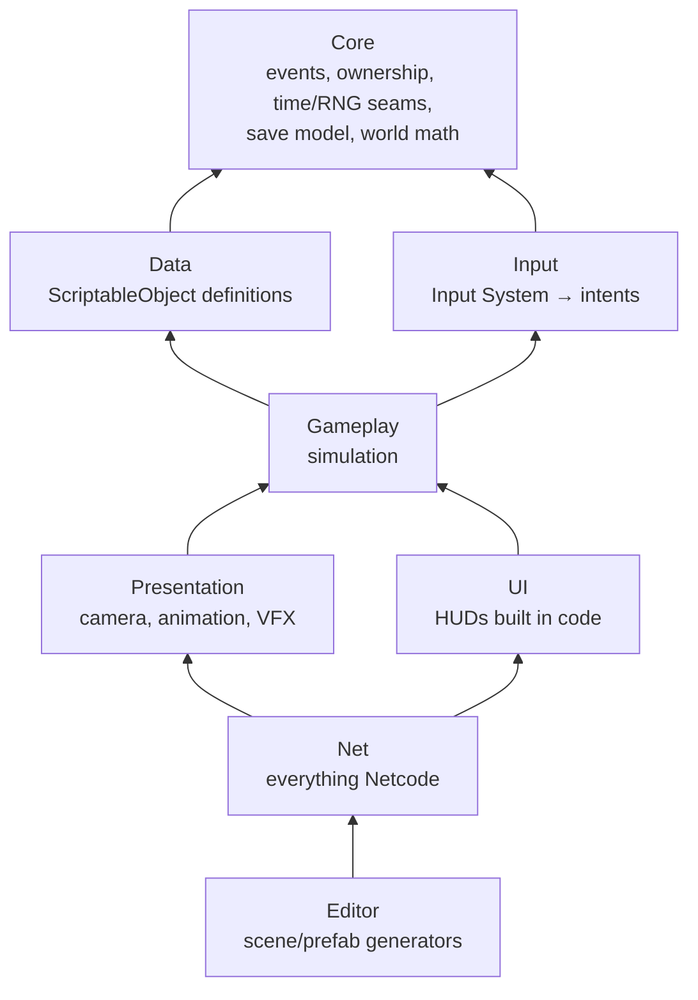
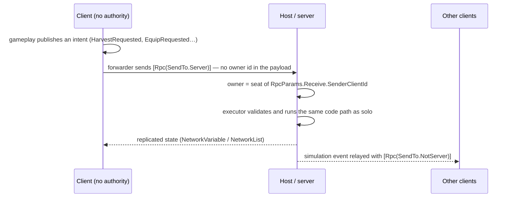

# Aethelgard — Unity multiplayer game (source code)

**Unity multiplayer game — source code showcase.** A co-op (1–4 players) 3D action RPG built
with Unity 6, URP and Netcode for GameObjects, with a server-authoritative game loop.

🇧🇷 [Leia em português](README.pt-BR.md)

> **Code only.** The game's art comes from licensed third-party packages (Unity Asset Store,
> Mixamo) that cannot be redistributed, so it is **not** in this repository — and neither are
> the scenes, prefabs and data assets generated from it. The project will not open as a
> playable game. What is here is everything written for the game: the C# scripts, the tests,
> the custom shaders and the project settings. See [What is not included](#what-is-not-included).

---

## The game

Players are *Synchronizers* in the world of Aethelgard: they fight creatures in real-time
combat, absorb an **Echo** of each defeated creature and turn it into one of up to five
equipped abilities — becoming what they defeat. Up to four friends play together on one
host; anyone can drop in or out and keep their progress.

The repository is at the **vertical-slice** stage: one hub-and-zones map, three enemy
archetypes, a boss, one capturable creature, and the systems around them.

### Glossary

Identifiers are in English; **code comments are in Brazilian Portuguese**. Terms you will
meet in them:

| Term in the code | Meaning |
|---|---|
| *Jogo da Trupe* | The project's working title ("the Troupe's game"); also the C# namespace `JogoDaTrupe.*` |
| *Trupe* | The party of up to 4 players |
| *Eco* (Echo) | The essence a defeated creature leaves to every player who damaged it |
| *Incorporação* | Turning an Echo into an equipped ability (5 slots), done at the **Altar** |
| *Sincronizar* | Capturing a weakened creature by holding the interact key |
| *Maestria* | Mastery: how many times a creature family was defeated; unlocks stronger ability layers |
| *Assento* (seat) | A player slot 0–3 in a co-op session (see [Netcode](#netcode)) |
| *Diretor* | The project's creative director, who makes the design calls |
| `M-NET-7 P3`, `M-TERR-5`… | Internal milestone / step identifiers |

## Features

What the code implements (each item maps to classes under `Assets/_Project/Scripts/`):

- **Online co-op for 1–4 players** — host + clients over Unity Transport (join by IP from the
  main menu), plus a solo mode. Drop-in/drop-out: a player who reconnects gets a seat back and
  resumes their progress; late joiners receive the current world state.
- **Real-time combat** — melee with cooldown, shield block that mitigates damage, stamina for
  sprinting and sliding, death and respawn. Third- and first-person cameras.
- **Adaptive enemies** — three archetypes (Berserker, Hit-and-run, Zigzag) that switch between
  aggressive, defensive and evasive stances based on distance and the player's attack rhythm;
  path following on a baked NavMesh; zone guarding around their spawn.
- **Adaptive boss** — health-based phases and resistance to the element the players repeat
  the most.
- **Ability system** — Echoes, five ability slots, XP and levels, specialization nodes, respec
  (costs materials), three mastery layers, elemental affinity across six elements (three
  opposing pairs) and character attributes with a soft penalty when a requirement is missed.
- **Creature capture** — weaken a creature to a threshold, then channel to capture it; in co-op
  the server arbitrates and the first valid request wins.
- **Survival/crafting loop** — resource nodes, a slot-based inventory, crafting at a workbench,
  grid-based building with a placement preview and an automated resource collector.
- **Save/load** — stateful systems implement `ISaveable` and each one serializes its own state
  to JSON in a single save file. In co-op only the host saves, and the data of players who are
  offline at that moment is preserved.
- **World built by code** — editor scripts generate the scenes: a sculpted terrain mesh from a
  pure height function, trail ribbons draped on it, villages from a modular kit, the NavMesh
  bake and the network prefabs.
- **Presentation** — HUDs built in code, particle VFX built in code, and four custom URP
  shaders (toon, flat low-poly, gradient skybox, particle glow).

## Tech stack

| | |
|---|---|
| Engine | Unity **6000.5.1f1** (Unity 6.5), Universal Render Pipeline 17.5 |
| Networking | Netcode for GameObjects **2.13.0**, Unity Transport, Multiplayer Play Mode 2.0 |
| Other packages | Input System 1.19, AI Navigation 2.0, Unity Test Framework 1.7 |
| Language | C# 9 (the Unity compiler's level) |
| Tests | NUnit EditMode tests (Unity Test Runner) + a .NET 8 headless runner for the core |
| CI | GitHub Actions: headless build + tests on pull requests that touch the core or the tests |

Exact package versions are in [`Packages/manifest.json`](Packages/manifest.json).

## Architecture

The scripts are split into **8 assemblies** (`.asmdef`), and the references only point down:



- **The network wall.** Only `Net` (and the editor tools) reference `Unity.Netcode`. Gameplay
  is network-agnostic: it reads three seams in `Core` — `SimulationAuthority` ("does this
  machine simulate the world?"), `LocalPlayer` and `Ownable` — and `Net` sets them. Each
  networked system gets a small *companion* (`NetworkHealth` next to `Health`,
  `NetworkInventory` next to `PlayerInventory`…) instead of turning gameplay classes into
  `NetworkBehaviour`s.
- **Events, not references.** Systems talk through a typed `EventBus<T>`; every event carries
  the `OwnerId` of the player it belongs to, so the same code works for one player or four.
- **Input → intent → action.** `PlayerInputReader` only translates devices into intents;
  gameplay acts on intents, never on keys.
- **Definition ≠ state.** Designer-tunable data lives in `ScriptableObject` definitions (items,
  recipes, abilities, enemies, structures); runtime state lives in plain classes and goes to
  the save file.
- **Pure logic, separately testable.** Rules are extracted from `MonoBehaviour`s into pure
  classes — `CombatMath`, `BossMath`, `CaptureMath`, `LoadoutMath`, `AltarMath`, `SaveMerge`,
  `SeatMath`, `WorldHeight`… — which is what the tests exercise.

## Netcode

Topology: a **host** (server + local player) and up to three clients. The host is the
authority for the world; clients send intents and mirror results.



**Intent → server executor → replicated state → local event.** On a client, gameplay does not
mutate the shared world; it publishes an *intent* event. Forwarders on the player prefab send
it to the server, where `WorldRequestExecutor` (harvest, craft, build, capture) and
`IncorporationRequestExecutor` (equip, unequip, invest, respec, attributes) execute it by
reusing the solo code paths — no duplicated rules. Results come back as replicated state
through companions (`NetworkInventory`, `NetworkLoadout`, `NetworkMemoryBank`,
`NetworkAttributes`, `NetworkAffinity`, `NetworkHealth`…; 18 `NetworkBehaviour`s in total).

**Event scopes.** `EventScopeRegistry` classifies each event type as *Presentation* (local
only), *Simulation* (decided on the server, relayed to clients) or *Intent* (client → server).
The default is local: an event nobody classified **cannot leak** over the network.
`EventScopeAdapter` relays simulation events with `SendTo.NotServer`, so the host — which
already handled the original event — does not get it twice; `EventRelay` adds a reentrancy
guard so a relayed event is never captured and sent again.

**Seats for drop-in/drop-out.** Netcode never reuses a client id, so identity is a **seat**
(0–3) handed out by `SeatRegistry` during connection approval: the lowest free seat, released
on disconnect and reused on reconnect. Save keys are per seat, so a returning player resumes
their character. `SaveMerge` keeps the data of seats that are offline when the host saves,
and `LateJoinWorldSync` re-announces world state that is not a replicated object.

**Server-side validation.**

- **The owner of a request comes from the connection, not from the client.** Every
  `SendTo.Server` RPC takes `RpcParams`; the server resolves the sender's seat from
  `RpcParams.Receive.SenderClientId` (`NetSeat.TryOfSender` → `SeatRegistry.TryResolveSender`).
  The payload carries no owner id, and a sender without a seat is ignored. This covers the 9
  world/incorporation RPCs, the 2 play-style RPCs and the damage RPC — a modified client
  cannot harvest, craft, build, capture, change the loadout or take kill credit **as another
  player**.
- Altar operations check the player's **real distance** to the Altar on the server
  (`AltarMath`), never the client's "I am at the Altar" flag.
- Equipping requires the Echo to be incorporable in the server's authoritative `MemoryBank`.
- Building debits the cost from the authoritative inventory before spawning the structure.
- Capture is arbitrated on the server: the first valid request wins and the creature despawns
  everywhere.

**Known limits** (documented in the code): player movement is owner-authoritative
(`ClientNetworkTransform`) for responsiveness in co-op among friends; the *amount* of damage
dealt to enemies is still reported by the client and not yet capped on the server; connection approval
only checks for a free seat (no room code, password or version check); clients connect by
direct IP, without a relay service.

## Engineering highlights

- **Testable core.** 49 EditMode test files with 282 `[Test]` methods cover the pure rules:
  combat, boss phases, capture, loadout, mastery, crafting, inventory, seats, save merging,
  event scopes, terrain and path geometry, among others.
- **Tests without Unity.** `Tools/HeadlessTests` compiles the original `Core` sources against
  a minimal `UnityEngine` shim and runs the core-only tests with `dotnet test` — 66 tests,
  fast enough for CI. A second project, `CompileCheck`, compiles the same tests against
  .NET Standard 2.1 and NUnit 3.5, the API surface Unity actually offers, so a test that
  only compiles on modern .NET fails in CI instead of in the editor. The shim turns
  `UnityEngine.Object == null` into a compile error, because Unity's "fake null" cannot be
  reproduced outside the engine.
- **Locked-down CI.** The workflow has a read-only token, never fetches Git LFS objects, does
  not persist credentials, cancels superseded runs and has a 10-minute timeout.
- **Code-generated content.** Scenes, prefabs and NavMesh are output of editor scripts (the
  *Jogo da Trupe → Setup* menus), so the world is reproducible and reviewed as code. Networked
  objects are spawned from prefabs instead of placed in scenes, avoiding the
  `GlobalObjectIdHash = 0` failure of generated in-scene `NetworkObject`s.
- **Determinism seams.** Simulation time and randomness go through `GameTime` and `GameRandom`
  providers instead of Unity's static `Time`/`Random`, so they can be swapped (in tests, or for
  a server clock and seed) without touching gameplay code.

## Running the tests

Requires the [.NET SDK 8](https://dotnet.microsoft.com/download/dotnet/8.0). No Unity needed:

```bash
dotnet build Tools/HeadlessTests/HeadlessTests.sln
dotnet test Tools/HeadlessTests/HeadlessTests.sln --no-build
```

Expected result: the solution builds (including `CompileCheck`) and **66 tests pass**. The
explicit `build` matters: `dotnet test` alone skips `CompileCheck`, which is not a test project.
Details in [`Tools/HeadlessTests/README.md`](Tools/HeadlessTests/README.md) (Portuguese).

The full EditMode suite runs inside Unity: *Window → General → Test Runner → EditMode → Run All*,
with Unity **6000.5.1f1**.

## What is not included

| Left out | Why |
|---|---|
| Third-party art: Unity Asset Store packages, Mixamo animations, a CC0 village kit | Licenses forbid redistribution (or the files are simply not ours to publish) |
| Scenes, prefabs, materials, data assets and NavMesh | Generated by the editor scripts, and they reference the art above |
| Design documents, lore and the development log | Kept private by the author |

The C# code depends only on Unity packages from `Packages/manifest.json` — no script from the
art packages is referenced. The scene generators, however, load the art from fixed paths under
`Assets/`, so regenerating the world requires the same packages.

## Status

In development — vertical-slice stage, not released. This repository is a code-only snapshot
of a private repository and is updated from it.

## License

The source code is released under the [MIT License](LICENSE). The names "Aethelgard" and
"Jogo da Trupe", the story and setting, logos and any artwork are **not** covered by it and
remain reserved. Third-party assets used by the full game are not included here and keep their
own licenses.

Security issues: see [SECURITY.md](SECURITY.md). Contributions: see
[CONTRIBUTING.md](CONTRIBUTING.md).
