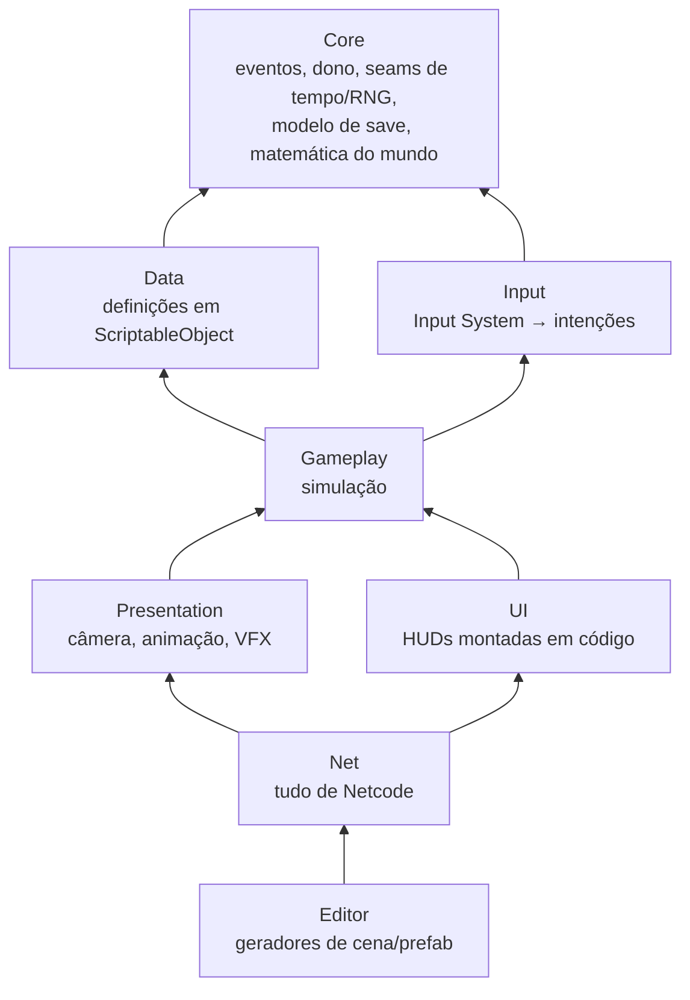
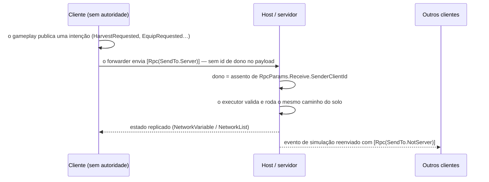

# Aethelgard — jogo multiplayer em Unity (código-fonte)

**Jogo multiplayer em Unity — vitrine do código-fonte.** Um RPG de ação 3D cooperativo (1 a 4
jogadores) feito com Unity 6, URP e Netcode for GameObjects, com o servidor como autoridade do
jogo.

🇺🇸 [Read in English](README.md)

> **Só o código.** A arte do jogo vem de pacotes licenciados de terceiros (Unity Asset Store,
> Mixamo) que não podem ser redistribuídos, então ela **não** está neste repositório — nem as
> cenas, prefabs e assets de dados gerados a partir dela. O projeto não abre como jogo jogável.
> O que está aqui é tudo o que foi escrito para o jogo: os scripts C#, os testes, os shaders
> próprios e as configurações do projeto. Veja [O que não está incluído](#o-que-não-está-incluído).

---

## O jogo

Os jogadores são *Sincronizadores* no mundo de Aethelgard: enfrentam criaturas em combate em
tempo real, absorvem o **Eco** de cada criatura derrotada e o transformam numa das até cinco
habilidades equipadas — tornando-se aquilo que derrotam. Até quatro amigos jogam juntos num
host; qualquer um pode entrar ou sair no meio da partida e manter o progresso.

O repositório está na fase de **vertical slice**: um mapa com hub central e zonas, três tipos de
inimigo, um chefe, uma criatura capturável e os sistemas em volta deles.

### Glossário

Os identificadores estão em inglês e os **comentários do código, em português**. Termos que
aparecem neles:

| Termo no código | Significado |
|---|---|
| *Jogo da Trupe* | Título provisório do projeto; também o namespace C# `JogoDaTrupe.*` |
| *Trupe* | O grupo de até 4 jogadores |
| *Eco* | A essência que a criatura derrotada deixa para cada jogador que a feriu |
| *Incorporação* | Transformar um Eco numa habilidade equipada (5 slots), feito no **Altar** |
| *Sincronizar* | Capturar uma criatura enfraquecida segurando a tecla de interação |
| *Maestria* | Quantas vezes uma família de criaturas foi derrotada; libera camadas mais fortes da habilidade |
| *Assento* | A vaga 0–3 de um jogador na sessão co-op (veja [Netcode](#netcode)) |
| *Diretor* | O diretor criativo do projeto, que toma as decisões de design |
| `M-NET-7 P3`, `M-TERR-5`… | Identificadores internos de marco / passo |

## Funcionalidades

O que o código implementa (cada item corresponde a classes em `Assets/_Project/Scripts/`):

- **Co-op online de 1 a 4 jogadores** — host + clientes pelo Unity Transport (entrada por IP
  no menu principal), além do modo solo. Drop-in/drop-out: quem reconecta recebe um assento de
  volta e retoma o progresso; quem entra depois recebe o estado atual do mundo.
- **Combate em tempo real** — corpo a corpo com recarga, bloqueio com escudo que reduz o dano,
  estamina para correr e deslizar, morte e respawn. Câmeras em 3ª e 1ª pessoa.
- **Inimigos adaptativos** — três arquétipos (Berserker, Bate-e-corre, Zigue-zague) que alternam
  entre posturas agressiva, defensiva e esquiva conforme a distância e o ritmo de ataque do
  jogador; seguem rotas numa NavMesh assada e guardam a zona em volta do ponto de spawn.
- **Chefe adaptativo** — fases por vida e resistência ao elemento que os jogadores mais repetem.
- **Sistema de habilidades** — Ecos, cinco slots, XP e níveis, nós de especialização, respec
  (custa material), três camadas de maestria, afinidade elemental com seis elementos (três pares
  opostos) e atributos de personagem com penalidade suave quando falta o requisito.
- **Captura de criaturas** — enfraquecer a criatura até um limiar e canalizar a captura; no
  co-op o servidor arbitra e o primeiro pedido válido leva.
- **Coleta e crafting** — nós de recurso, inventário em slots, crafting na bancada, construção
  em grade com prévia de posicionamento e um coletor automático de recursos.
- **Salvar/carregar** — os sistemas com estado implementam `ISaveable` e cada um serializa o
  próprio estado em JSON, num único arquivo. No co-op só o host salva, e os dados de quem está
  offline naquele momento são preservados.
- **Mundo gerado por código** — scripts de editor geram as cenas: a malha do terreno esculpida
  a partir de uma função de altura pura, as trilhas drapeadas sobre ela, vilas de um kit
  modular, o bake da NavMesh e os prefabs de rede.
- **Apresentação** — HUDs montadas em código, VFX de partículas montados em código e quatro
  shaders URP próprios (toon, low-poly chapado, céu em gradiente, brilho de partícula).

## Stack

| | |
|---|---|
| Engine | Unity **6000.5.1f1** (Unity 6.5), Universal Render Pipeline 17.5 |
| Rede | Netcode for GameObjects **2.13.0**, Unity Transport, Multiplayer Play Mode 2.0 |
| Outros pacotes | Input System 1.19, AI Navigation 2.0, Unity Test Framework 1.7 |
| Linguagem | C# 9 (o nível do compilador da Unity) |
| Testes | Testes NUnit EditMode (Test Runner da Unity) + um executor headless em .NET 8 para o núcleo |
| CI | GitHub Actions: build + testes headless nos pull requests que mexem no núcleo ou nos testes |

As versões exatas dos pacotes estão em [`Packages/manifest.json`](Packages/manifest.json).

## Arquitetura

Os scripts são divididos em **8 assemblies** (`.asmdef`), e as referências só apontam para baixo:



- **A parede da rede.** Só `Net` (e as ferramentas de editor) referenciam `Unity.Netcode`. O
  gameplay não sabe que existe rede: ele lê três *seams* do `Core` — `SimulationAuthority`
  ("esta máquina simula o mundo?"), `LocalPlayer` e `Ownable` — e quem os escreve é o `Net`.
  Cada sistema em rede ganha um pequeno *companion* (`NetworkHealth` ao lado do `Health`,
  `NetworkInventory` ao lado do `PlayerInventory`…), em vez de virar `NetworkBehaviour`.
- **Eventos, não referências.** Os sistemas conversam por um `EventBus<T>` tipado; todo evento
  carrega o `OwnerId` do jogador a que pertence, então o mesmo código serve para um ou quatro
  jogadores.
- **Input → intenção → ação.** O `PlayerInputReader` só traduz dispositivos em intenções; o
  gameplay age sobre intenções, nunca sobre teclas.
- **Definição ≠ estado.** O que o designer ajusta mora em definições `ScriptableObject` (itens,
  receitas, habilidades, inimigos, estruturas); o estado de runtime mora em classes comuns e vai
  para o save.
- **Lógica pura, testável à parte.** As regras saem dos `MonoBehaviour`s para classes puras —
  `CombatMath`, `BossMath`, `CaptureMath`, `LoadoutMath`, `AltarMath`, `SaveMerge`, `SeatMath`,
  `WorldHeight`… —, que são o que os testes exercitam.

## Netcode

Topologia: um **host** (servidor + jogador local) e até três clientes. O host é a autoridade do
mundo; os clientes mandam intenções e espelham os resultados.



**Intenção → executor no servidor → estado replicado → evento local.** No cliente, o gameplay
não altera o mundo compartilhado; ele publica um evento de *intenção*. Os forwarders do prefab
do jogador o levam ao servidor, onde o `WorldRequestExecutor` (coleta, crafting, construção,
captura) e o `IncorporationRequestExecutor` (equipar, desequipar, investir, respec, atributos)
o executam reaproveitando o caminho do solo — sem regra duplicada. O resultado volta como estado
replicado pelos companions (`NetworkInventory`, `NetworkLoadout`, `NetworkMemoryBank`,
`NetworkAttributes`, `NetworkAffinity`, `NetworkHealth`…; 18 `NetworkBehaviour`s no total).

**Escopos de evento.** O `EventScopeRegistry` classifica cada tipo de evento como
*Presentation* (só local), *Simulation* (decidido no servidor e reenviado aos clientes) ou
*Intent* (cliente → servidor). O padrão é local: um evento que ninguém classificou **não vaza**
pela rede. O `EventScopeAdapter` reenvia os eventos de simulação com `SendTo.NotServer`, para o
host — que já tratou o evento original — não recebê-lo duas vezes; o `EventRelay` acrescenta uma
guarda de reentrada para um evento reenviado nunca ser capturado e mandado de novo.

**Assentos para drop-in/drop-out.** O Netcode nunca reaproveita um client id, então a
identidade é um **assento** (0–3) distribuído pelo `SeatRegistry` na aprovação da conexão: o
menor livre, liberado na desconexão e reaproveitado na reconexão. As chaves de save são por
assento, então quem volta retoma o personagem. O `SaveMerge` preserva os dados dos assentos
offline quando o host salva, e o `LateJoinWorldSync` reanuncia o estado do mundo que não é
objeto replicado.

**Validação no servidor.**

- **O dono de um pedido vem da conexão, não do cliente.** Todo RPC `SendTo.Server` recebe
  `RpcParams`; o servidor resolve o assento do remetente por `RpcParams.Receive.SenderClientId`
  (`NetSeat.TryOfSender` → `SeatRegistry.TryResolveSender`). O payload não leva id de dono, e
  um remetente sem assento é ignorado. Isso vale para os 9 RPCs de mundo/incorporação, os 2 de
  estilo de jogo e o de dano — um cliente modificado não consegue coletar, craftar, construir,
  capturar, mudar o loadout nem levar o crédito de uma morte **em nome de outro jogador**.
- As operações do Altar conferem a **distância real** do jogador até o Altar no servidor
  (`AltarMath`), nunca a flag "estou no Altar" do cliente.
- Equipar exige que o Eco esteja incorporável no `MemoryBank` autoritativo do servidor.
- Construir debita o custo do inventário autoritativo antes de spawnar a estrutura.
- A captura é arbitrada no servidor: o primeiro pedido válido leva e a criatura some em todas
  as telas.

**Limites conhecidos** (documentados no código): o movimento do jogador tem autoridade do dono
(`ClientNetworkTransform`), pela resposta imediata no co-op entre amigos; o *valor* do dano
causado aos inimigos ainda vem do cliente e não tem teto no servidor; a aprovação de conexão só
confere se há assento livre (sem código de sala, senha ou checagem de versão); os clientes
conectam por IP direto, sem serviço de relay.

## Destaques de engenharia

- **Núcleo testável.** 49 arquivos de teste EditMode com 282 métodos `[Test]` cobrem as regras
  puras: combate, fases do chefe, captura, loadout, maestria, crafting, inventário, assentos,
  fusão de saves, escopos de evento, geometria do terreno e das trilhas, entre outras.
- **Testes sem Unity.** O `Tools/HeadlessTests` compila os fontes originais do `Core` contra um
  *shim* mínimo de `UnityEngine` e roda os testes só-núcleo com `dotnet test` — 66 testes,
  rápidos o bastante para o CI. Um segundo projeto, `CompileCheck`, compila os mesmos testes
  contra .NET Standard 2.1 e NUnit 3.5, a superfície de API que a Unity de fato oferece: um
  teste que só compila no .NET moderno falha no CI em vez de falhar no editor. O shim transforma
  `UnityEngine.Object == null` em erro de compilação, porque o "null falso" da Unity não pode
  ser reproduzido fora da engine.
- **CI fechado.** O workflow tem token só de leitura, nunca baixa objetos do Git LFS, não guarda
  credenciais, cancela execuções obsoletas e tem timeout de 10 minutos.
- **Conteúdo gerado por código.** Cenas, prefabs e NavMesh são saída de scripts de editor (os
  menus *Jogo da Trupe → Setup*), então o mundo é reproduzível e revisado como código. Objetos de
  rede são spawnados a partir de prefabs em vez de colocados na cena, evitando a falha de
  `GlobalObjectIdHash = 0` dos `NetworkObject`s gerados dentro da cena.
- **Seams de determinismo.** Tempo e aleatoriedade da simulação passam pelos provedores
  `GameTime` e `GameRandom` em vez do `Time`/`Random` estáticos da Unity, então podem ser
  trocados (nos testes, ou por um relógio e uma semente do servidor) sem mexer no gameplay.

## Como rodar os testes

Precisa do [.NET SDK 8](https://dotnet.microsoft.com/download/dotnet/8.0). Não precisa de Unity:

```bash
dotnet build Tools/HeadlessTests/HeadlessTests.sln
dotnet test Tools/HeadlessTests/HeadlessTests.sln --no-build
```

Resultado esperado: a solução compila (inclusive o `CompileCheck`) e **66 testes passam**. O
`build` explícito importa: o `dotnet test` sozinho pula o `CompileCheck`, que não é projeto de
teste. Detalhes em [`Tools/HeadlessTests/README.md`](Tools/HeadlessTests/README.md).

A suíte EditMode completa roda dentro da Unity: *Window → General → Test Runner → EditMode →
Run All*, com a Unity **6000.5.1f1**.

## O que não está incluído

| Ficou de fora | Por quê |
|---|---|
| Arte de terceiros: pacotes da Unity Asset Store, animações do Mixamo, um kit de vilas CC0 | As licenças proíbem redistribuir (ou os arquivos simplesmente não são nossos para publicar) |
| Cenas, prefabs, materiais, assets de dados e NavMesh | São gerados pelos scripts de editor e apontam para a arte acima |
| Documentos de design, lore e o log de desenvolvimento | O autor os mantém privados |

O código C# depende só dos pacotes da Unity listados em `Packages/manifest.json` — nenhum script
dos pacotes de arte é referenciado. Os geradores de cena, porém, carregam a arte de caminhos
fixos em `Assets/`, então regerar o mundo exige os mesmos pacotes.

## Status

Em desenvolvimento — fase de vertical slice, sem lançamento. Este repositório é um retrato só do
código de um repositório privado e é atualizado a partir dele.

## Licença

O código-fonte é distribuído sob a [Licença MIT](LICENSE). Os nomes "Aethelgard" e "Jogo da
Trupe", a história e o cenário, logos e qualquer arte **não** estão cobertos por ela e continuam
reservados. Os assets de terceiros usados pelo jogo completo não estão aqui e seguem as próprias
licenças.

Problemas de segurança: veja [SECURITY.md](SECURITY.md). Contribuições: veja
[CONTRIBUTING.md](CONTRIBUTING.md).
